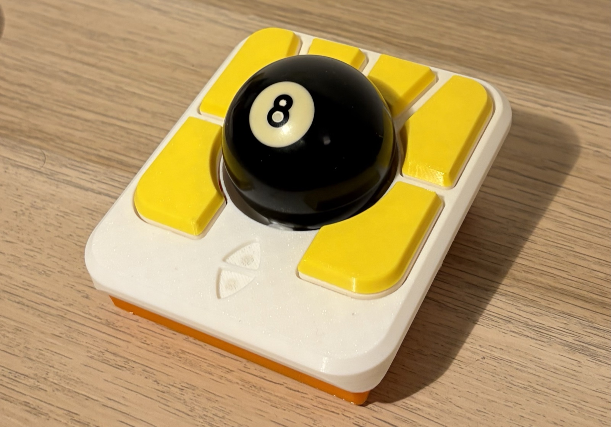
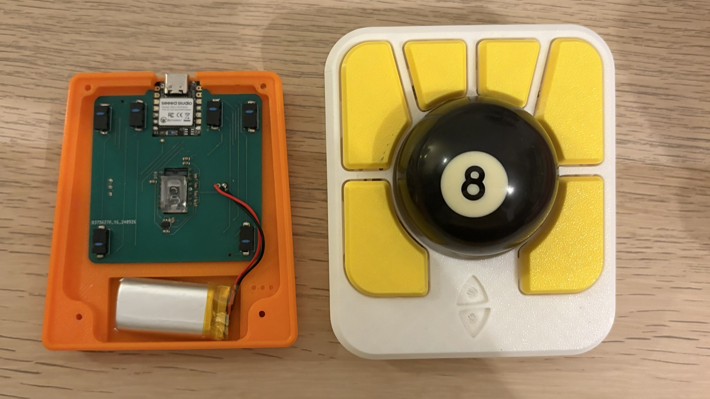
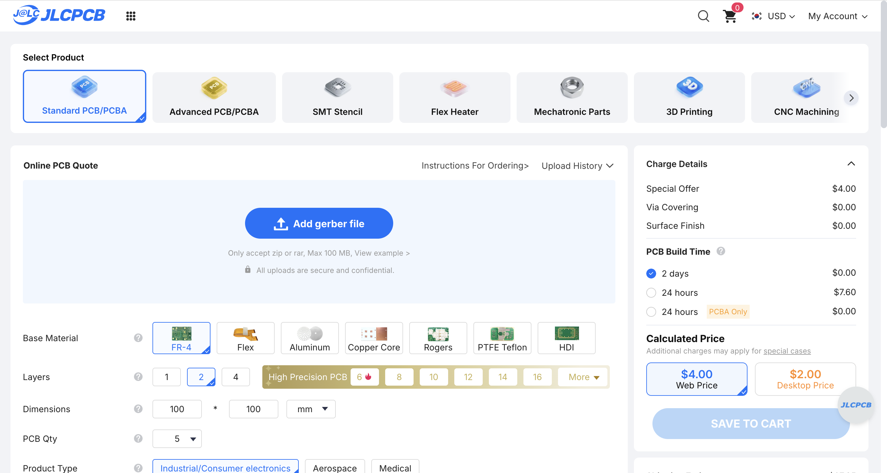
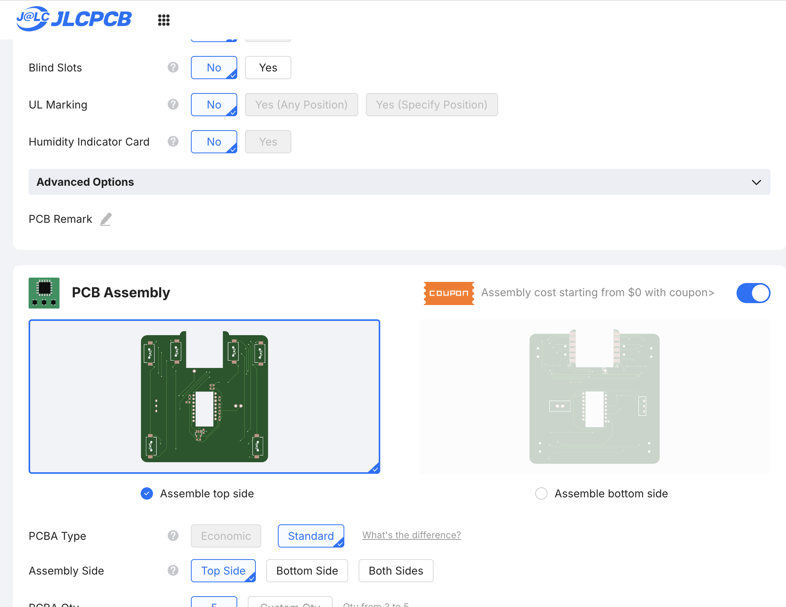
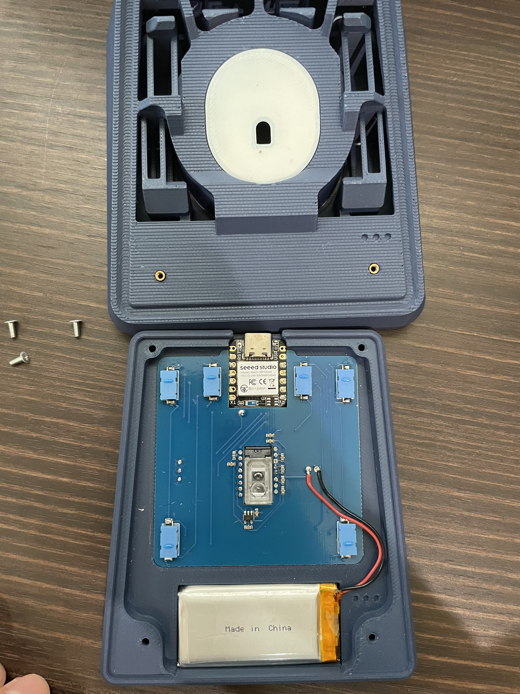
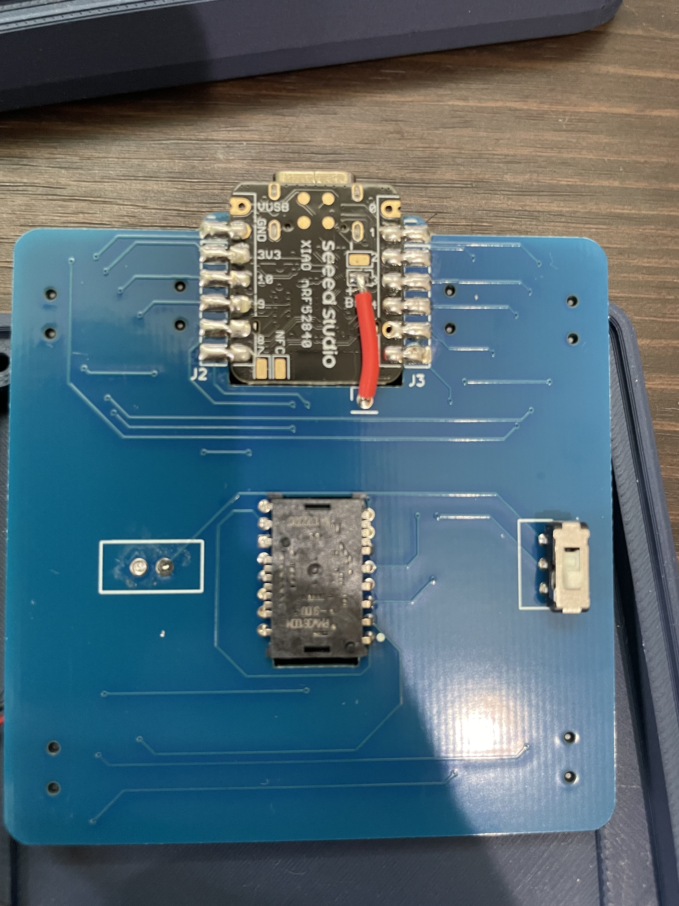

# AdeptBLE

A wireless Bluetooth modification of the Ploopy Adept trackball. It's based on the open-source [Ploopy Adept](https://github.com/ploopyco/adept-trackball) design. It replaces the original PCB with a XIAO nRF52840 based board running ZMK, and adds a modified bottom housing.

To learn how to pair the trackball and what each button does, see [USAGE.md](./USAGE.md).

## Finished build

My build uses `housing/AdeptBLE_bottom.3mf` for the bottom housing and a top housing from [Adept Anyball](https://github.com/adept-anyball/mod), the [50-55mm ball](https://github.com/adept-anyball/mod/tree/master/50-55mm%20ball) variant. This variant is designed for a 50–55 mm ball and BTUs. Its files aren't included in this repository, so download them from the link. 

## 1. Repository contents

| Path | Contents |
| --- | --- |
| `electronics/` | KiCad 7 project for the PCB |
| `JLCPCB/` | Gerbers (`sensor.zip`), BOM (`bom.csv`) and placement file (`positions.csv`) |
| `firmware/` | Prebuilt ZMK firmware (`.uf2`) |
| `housing/` | Modified bottom housing (`.step`, `.3mf`) |

The firmware source is in [taichan1113/mouse-test](https://github.com/taichan1113/mouse-test/tree/main).

## 2. Parts

### Electronics

U1, the mouse switches and the JLCPCB-assembled parts go on the front. The XIAO, the sensor, the slide switch and the battery wires go on the back.

All the components are listed in the BOM file. You can order the board from JLCPCB with about half of the components already soldered, but you need to solder the rest yourself.

### Assembled by JLCPCB

| Ref | Value | Part | LCSC part | Type |
| --- | --- | --- | --- | --- |
| C2, C4, C6, C7 | 100 nF | CC0603KRX7R9BB104 | C14663 | Basic |
| C1, C9 | 10 nF | 0603B103K500NT | C57112 | Basic |
| C3 | 3.3 µF | C1608X5R1E335KT000E | C342962 | Extended |
| C5 | 1 µF | CL10A105KB8NNNC | C15849 | Basic |
| R1 | 2 MΩ | 0603WAF2004T5E | C22976 | Basic |
| C8 | 10 µF | CL10A106KP8NNNC | C19702 | Basic |

### Soldered by hand

| Ref | Part | Description | Solder by hand |
| --- | --- | --- | --- |
| U1 | TCR2EF19 (SOT-23-5) | Voltage regulator | Possibly |
| SW1–SW6 | D2LS-21 | Mouse switches | Possibly |
| J2, J3, J4 | XIAO nRF52840 | Board | Yes |
| U2 | PMW3610 | Optical sensor | Yes |
| PSW1 | 6-pin slide switch | Power switch | Yes |
| J1 | LiPo battery | Battery, soldered with wire | Yes |

### Other parts

- A Ploopy Adept top housing. The default top housing is in Ploopy's [mechanical files](https://github.com/ploopyco/adept-trackball/tree/master/hardware/mechanicals), and it's more compatible with the modified bottom housing than the mods. You can also find top housings with various mods [here](https://github.com/adept-anyball/mod).
- The modified bottom housing, printed from `housing/AdeptBLE_bottom.3mf`
- BTUs or ceramic/steel balls to support the ball.

Note: I used the [50-55mm ball version mod housing](https://github.com/adept-anyball/mod/tree/master/50-55mm%20ball), which is still based on the original-sized housing. There is no modified AdeptBLE bottom housing for the short/thin version.

## 3. Tutorial
### 1) Ordering the PCB from JLCPCB

1. Upload `JLCPCB/production_file/sensor.zip` as the Gerber file.

2. Turn on PCB Assembly and choose assembly on the top side.

3. Click Next, then upload `JLCPCB/bom/bom.csv` as the BOM and `JLCPCB/position/positions.csv` as the CPL.
4. Select parts only for C1–C9 and R1, using the LCSC parts in [Assembled by JLCPCB](#assembled-by-jlcpcb). Leave the other designators unselected.
5. Check the placement preview before you confirm the order.

### 2) Assembly

The front of the board has U1, the mouse switches and the JLCPCB-assembled parts. The back has the XIAO, the sensor, the slide switch and the battery wires.

#### 1. Solder U1 and the mouse switches

Solder U1 to the front of the board, matching its orientation to the footprint. Then solder SW1–SW6 to the front of the board. Each switch has two pads, and two pegs that locate it in the board. Make sure each switch sits flat before you solder the second pad.

#### 2. Fit the sensor and lens

**Please check that the sensor is oriented correctly! This is a common pitfall!**

Place the PMW3610 on the back of the board, over the rectangular cutout, and line up pin 1 with the dot on the silkscreen. Solder its pins. Leave the protective film on the sensor while you solder. Fit the lens from the front.

#### 3. Fit the slide switch

PSW1 has two rows of three pins, but the board only has holes for one row. Cut the pins on one side, then solder the other three pins to the back of the board, with the slider facing away from the board and the switch body toward the board edge. Check that the switch doesn't touch the desk once it's in the housing.

#### 4. Connect the XIAO

The XIAO sits in the cutout at the edge of the board, with its underside flush with the back of the PCB. Please check the photo. 

***Please double-check the orientation of the board!***

1. Set the XIAO into the cutout from the back. The `BAT+` pad on the XIAO's underside stays visible from the back.
2. Solder the XIAO edge pads to J2 and J3. The two pads nearest the USB connector, `D0` and `5V`, stay unconnected.
3. Solder a short wire from `BAT+` to J4, which is the single hole just past the end of the cutout.

| PCB | XIAO | Function |
| --- | --- | --- |
| J3 pins 1–6 | D1–D6 | SW1–SW6 |
| J2 pin 1 | GND | Ground |
| J2 pin 2 | 3V3 | Power |
| J2 pin 3 | D10 | Sensor MOTION |
| J2 pin 4 | D9 | Sensor SDIO |
| J2 pin 5 | D8 | Sensor SCLK |
| J2 pin 6 | D7 | Sensor NCS |
| J4 | BAT+ | Battery, through PSW1 |

The battery negative reaches the XIAO through the board ground, so it needs no separate wire.

### 5. Flash and test

Test the board before you connect the battery or close the housing.

1. Connect the XIAO to your computer over USB.
2. Double-press the reset button on the XIAO. A USB drive appears.
3. Copy `firmware/mouse_test-seeeduino_xiao_ble-zmk.uf2` to the drive. The XIAO restarts when the copy finishes.
4. Pair the device from your computer's Bluetooth settings.
5. Check that all six switches work and that the sensor tracks.

The switches map to keymap positions in order, so SW1 is position 0 and SW6 is position 5. To see what each button does, go to [Buttons](./USAGE.md#buttons). To change what they do, edit `config/AdeptBLE.keymap` in the [firmware repository](https://github.com/taichan1113/mouse-test/tree/main). The prebuilt `.uf2` is an older build, so its behavior may differ from the current source.

### 6. Connect the battery

Solder the battery wires to J1. The silkscreen doesn't mark the polarity. Pin 1, the hole closer to the sensor, is positive, and pin 2, the hole closer to the board edge, is ground. Check the polarity with a multimeter before you solder, because reversing it can damage the board.

The battery only connects to the XIAO when PSW1 is on, so the switch must also be on for the battery to charge over USB.

### 7. Close the housing

1. Place the board in the modified bottom housing.
2. Route the battery wire so that neither housing half pinches it.
3. Check that the cut slide switch pins don't reach past the bottom of the housing.
4. Fit the top housing and test again.

**Note:** On my build with the mod top housing, even a slight misalignment of the top housing stops the buttons from clicking reliably. Line up the top housing carefully, so that each button sits over its switch, and test every button before you fully tighten the housing.

## License

See [LICENSE](./LICENSE). The schematic is licensed under CC BY-NC-SA 4.0.
